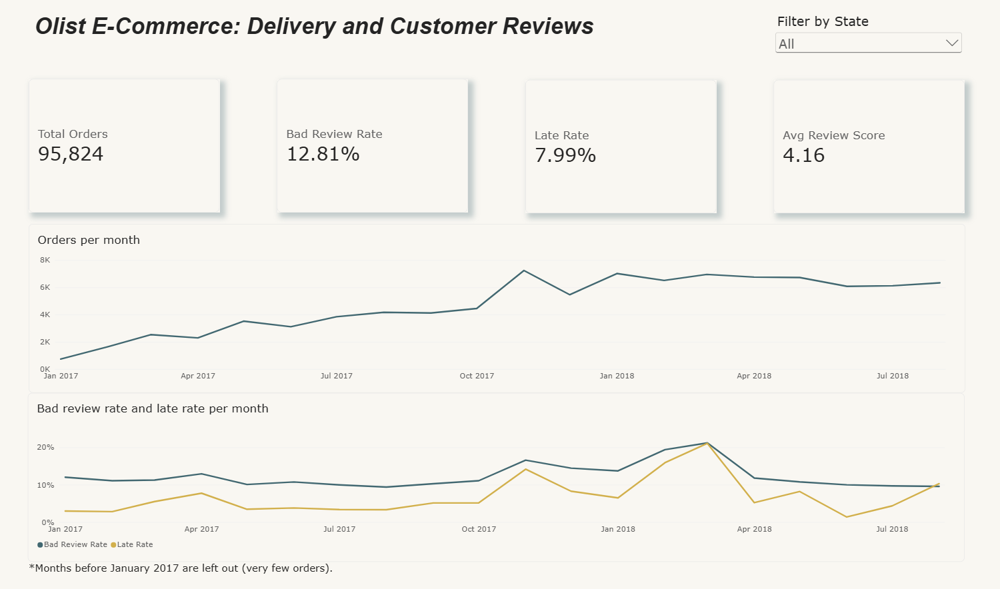
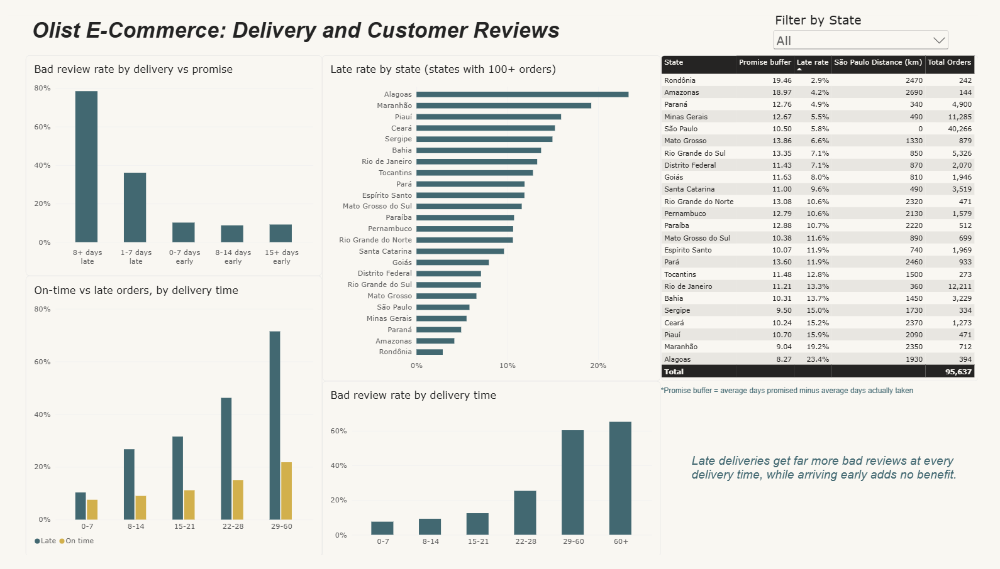
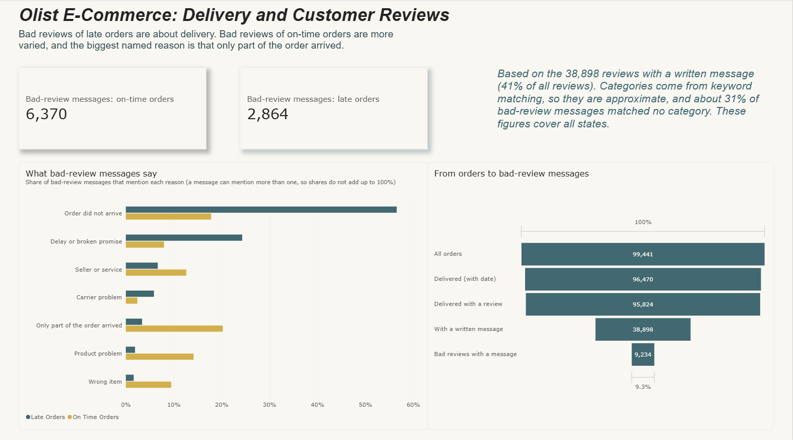
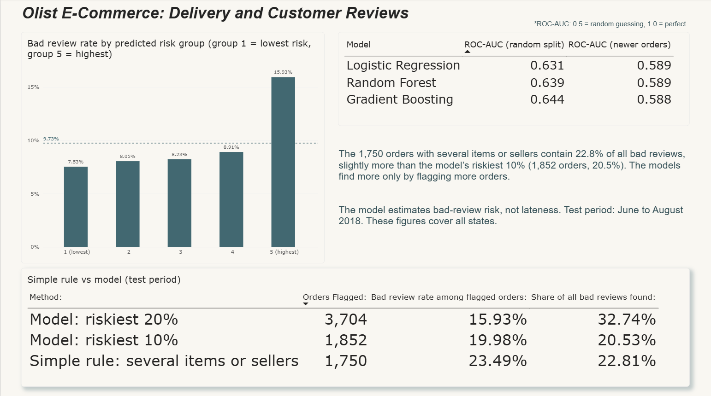
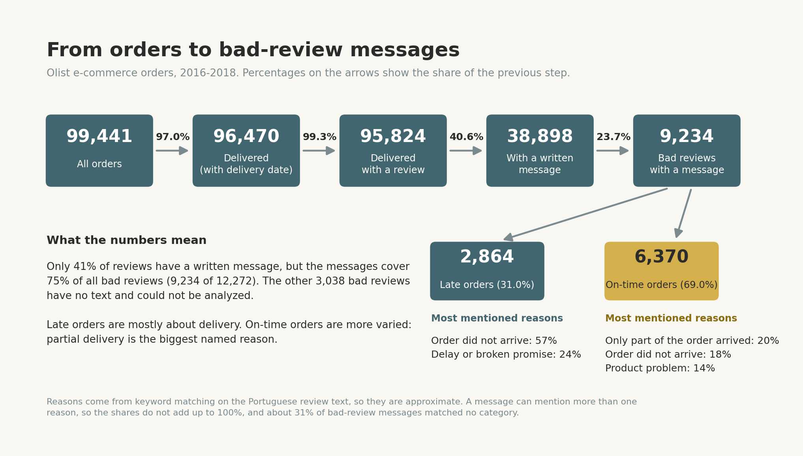

# Olist E-Commerce: Which Orders Get Bad Reviews?

An end-to-end analytics project on about 100,000 orders from a Brazilian online marketplace: data cleaning in Python, analysis of delivery and customer reviews, machine learning models, a text analysis of review messages, and a four-page Power BI dashboard.

**Main question:** which orders are likely to be delivered late or get a bad review (1-2 stars), and what causes it?

## Key findings

- **Late delivery is the strongest single signal, but it explains only about a third of the bad reviews.** 54% of late orders get a bad review, against 9% of on-time orders. Still, about two thirds of all bad reviews (roughly 8,100 of 12,300) come from orders that arrived on time.
- **A broken promise hurts more than a long wait.** From 8 days of waiting on, late orders get about three times as many bad reviews as on-time orders with the same delivery time. Arriving earlier than promised does not improve reviews.
- **Orders with several items or sellers are a hidden problem.** They are about 10% of all orders, but their bad review rate is 25-34% (one item: 11%), and 46% for two sellers (one seller: 12%). About half of the bad reviews of such orders that arrived on time say that only part of the order arrived.
- **The review messages tell different stories.** Bad reviews of late orders are about delivery (57% say the order did not arrive). Bad reviews of on-time orders are more varied, and the biggest named reason is that only part of the order arrived (20%).
- **Machine learning adds little at purchase time.** Three models reach a ROC-AUC of 0.63-0.64 (0.59 on newer orders), and a one-line rule ("the order has several items or sellers") finds bad reviews about as well as the models.

## Dashboard

The Power BI report has four pages. It covers delivered orders with a review. The two line charts on page 1 start in January 2017, because earlier months have very few orders.

| Page | What it shows |
| --- | --- |
| **Overview** | Orders, bad review rate, late rate and average score, per month |
| **Delivery vs Promise** | Bad reviews by delivery time and by delivery vs promise, late rate by state |
| **What Customers Say** | Reasons in the bad-review messages, from orders to messages |
| **Predicting Risk** | Model comparison, risk groups, simple rule vs model |









## Data

[Brazilian E-Commerce Public Dataset by Olist](https://www.kaggle.com/datasets/olistbr/brazilian-ecommerce) on Kaggle: about 100k orders from 2016 to 2018, in 9 related tables (orders, items, customers, sellers, products, payments, reviews, geolocation and a category translation table). The raw files are not included in this repository. Please see the dataset page for its license.

From 99,441 orders, 95,824 are used: delivered orders with a delivery date and a review.



## What I did

1. **Loaded and checked the data.** Missing values, order status, duplicate reviews (551 extra review rows, keeping the latest per order).
2. **Built one table with one row per order.** Items, customers, products and sellers were summarized and joined (price, freight, number of items and sellers, weight, category, seller and customer state).
3. **Created features known at purchase time** (promised delivery days, freight, weight, category, states, whether customer and seller are in the same state, weekday) and analysis columns known only after delivery (late or not, delivery days).
4. **Analyzed delivery, promise and reviews** by state, delivery time and month.
5. **Analyzed the review messages.** Portuguese text was cleaned and the bad-review messages were grouped into reasons with keyword matching.
6. **Trained and compared models** (Logistic Regression, Random Forest, Gradient Boosting) with a random split and with a time-based split (train on orders before June 2018, test on June-August 2018).
7. **Exported the results and built the Power BI dashboard.**

## Results

### Delivery and reviews

| | Orders | Bad review rate |
| --- | --- | --- |
| On-time orders | 88,163 | 9.2% |
| Late orders | 7,661 | 54.1% |

Average review score: 4.3 for on-time orders and 2.6 for late orders. Median delivery time is 10 days (mean 12.1), while the average promise is 23.4 days.

**Delivery compared with the promise:**

| Delivery vs estimated date | Orders | Bad review rate |
| --- | --- | --- |
| 8+ days late | 3,252 | 78.4% |
| 1-7 days late | 4,409 | 36.1% |
| 0-7 days early | 22,034 | 10.2% |
| 8-14 days early | 36,676 | 8.7% |
| 15+ days early | 29,453 | 9.2% |

**Waiting time and broken promise, separated** (bad review rate):

| Real delivery time | On-time orders | Late orders |
| --- | --- | --- |
| 0-7 days | 7.5% | 10.3% |
| 8-14 days | 9.0% | 26.7% |
| 15-21 days | 11.2% | 31.5% |
| 22-28 days | 15.0% | 46.2% |
| 29-60 days | 21.8% | 71.4% |

Waiting alone raises the bad review rate (from 7.5% to 21.8% for on-time orders), but being late raises it much more.

### States

Olist promises a different time buffer (promised days minus real days) in each state. States with a small buffer have the most late deliveries. Across the 24 states with 100+ orders, the correlation between buffer and late rate is about -0.73.

| State | Orders | Promise buffer (days) | Late rate | Bad review rate |
| --- | --- | --- | --- | --- |
| Alagoas | 394 | 8.3 | 23.4% | 21.3% |
| Maranhão | 712 | 9.0 | 19.2% | 19.9% |
| Sergipe | 334 | 9.5 | 15.0% | 18.9% |
| Rio de Janeiro | 12,211 | 11.2 | 13.3% | 18.3% |
| São Paulo | 40,266 | 10.5 | 5.8% | 10.7% |

Rio de Janeiro stands out: it is close to the main seller state (about 360 km from São Paulo) and has a normal buffer, but a late rate and bad review rate close to the north-eastern states. The data does not explain why.

### Several items or sellers

| Items in the order | Orders | Bad review rate |
| --- | --- | --- |
| 1 | 86,296 | 11.3% |
| 2 | 7,319 | 25.4% |
| 3 | 1,286 | 29.1% |
| 4 | 487 | 34.3% |

Orders with two sellers (1,202 orders) have a 46.3% bad review rate; orders with one seller, 12.3%.

### What the review messages say

38,898 of the 95,824 reviews have a written message, and 75% of all bad reviews have one (9,234 of 12,272). Share of the bad-review messages that mention each reason:

| Reason | Late orders (2,864 messages) | On-time orders (6,370 messages) |
| --- | --- | --- |
| Order did not arrive | **56.6%** | 17.8% |
| Delay or broken promise | **24.3%** | 8.0% |
| Only part of the order arrived | 3.4% | **20.2%** |
| Product problem | 1.9% | **14.1%** |
| Seller or service | 6.7% | 12.6% |
| Wrong item | 1.6% | 9.5% |
| Carrier problem | 5.9% | 2.4% |

A message can mention more than one reason, so the columns do not add up to 100%. About 31% of the bad-review messages match no reason.

The "only part of the order arrived" reason is concentrated in orders with several items or sellers: it appears in 53.5% of the bad-review messages of such orders that arrived on time, against 6.1% for single-item orders.

### Models

All models use only information known at the time of purchase. The bad review rate is 12.8%, so a model that always says "good review" is right 87% of the time but finds no bad reviews. That is why the models are compared with ROC-AUC (0.5 = random guessing, 1.0 = perfect) and recall.

| Model | ROC-AUC (random split) | Recall | Precision | ROC-AUC (newer orders) |
| --- | --- | --- | --- | --- |
| Logistic Regression | 0.631 | 0.521 | 0.192 | 0.589 |
| Random Forest | 0.639 | 0.498 | 0.199 | 0.589 |
| Gradient Boosting | 0.644 | 0.485 | 0.211 | 0.588 |

The more complex models do not help: the limit is the information in the data, not the algorithm.

**Experiments** (Gradient Boosting):

| Experiment | ROC-AUC |
| --- | --- |
| Main model (random split) | 0.644 |
| Adding `is_late` (not known at purchase time) | 0.746 |
| Adding the purchase month | 0.658 |
| Trained on older orders, tested on newer orders | 0.588 |

- Knowing in advance that an order will be late raises the ROC-AUC the most, which shows what is missing at purchase time.
- The purchase month is not used. It mostly marks the period (February 2017 and February 2018 were very different), and that does not carry over to future orders.
- A random split gives better scores than testing on newer orders, so the time-based split is the more honest estimate.

**Risk groups** (test period, June-August 2018: 18,520 orders, 9.7% bad reviews). Orders are split into 5 equal groups by the model's risk score:

| Risk group | Bad review rate |
| --- | --- |
| 1 (lowest) | 7.53% |
| 2 | 8.05% |
| 3 | 8.23% |
| 4 | 8.91% |
| 5 (highest) | **15.93%** |

The model separates the riskiest 20% of orders (about a third of all bad reviews are in that group), but it cannot tell the other four groups apart. Its risk score does not follow late delivery: the lowest-risk group has the highest late rate (10.1%).

**A simple rule works about as well:**

| Method | Orders flagged | Bad review rate | Share of all bad reviews found |
| --- | --- | --- | --- |
| Simple rule: several items or sellers | 1,750 | 23.5% | 22.8% |
| Model: riskiest 10% | 1,852 | 20.0% | 20.5% |
| Model: riskiest 20% | 3,704 | 15.9% | 32.7% |

The rule flags about as many orders as the model's riskiest 10% and finds slightly more bad reviews. The model finds more only by flagging more orders, and 34% of the model's highest-risk group are orders with several items or sellers.

## Recommendations

These come from the patterns in the data. The data cannot prove their effect, so they are things to investigate or test.

1. **Look at orders with several items or sellers.** Show the status of each package, and mark an order as delivered only when all of it has arrived (or tell the customer in advance when parts ship separately). This is the clearest and most actionable pattern in the data.
2. **Review the delivery promise in states with a small buffer** (for example Alagoas, Maranhão and Sergipe). A longer promise could reduce late deliveries, but the data does not show its effect on sales, so it should be tested.
3. **Prepare for peak periods.** The late rate reached 14% in November 2017 and 21% in March 2018, with bad reviews rising at the same time.
4. **Investigate Rio de Janeiro.** It has a late rate and bad review rate close to the north-eastern states despite a short distance and a normal buffer.

## Limitations

- Only delivered orders with a review are used (95.8k of 99.4k). Canceled orders and customers who did not write a review are not included.
- For orders with several items or sellers, the category and the seller state come from the first item only.
- Distances are straight lines to the state capital, not real road distances.
- The data does not show whether a larger delivery-promise buffer would reduce sales.
- The data has no information about product quality, damaged items or seller communication, so it cannot explain most bad reviews of on-time orders.
- The review reasons come from keyword matching on Portuguese text, so they are approximate. Customers who write a message may differ from those who do not.
- In the time-based split, the test period is June-August 2018, and August 2018 is the last month of the data.

## Repository

```
olist-ecommerce-analytics/
├── ecommerce.ipynb        # the full analysis (data cleaning, analysis, review text, models, export)
├── ecommerce_pbi.pbix     # Power BI report (4 pages)
├── requirements.txt       # Python libraries
├── .gitignore             # keeps the virtual environment, raw data and CSV exports out of GitHub
├── images/                # charts and dashboard screenshots used in this README
└── README.md
```

## How to run

1. Create and activate a virtual environment, then install the libraries:
   ```
   python -m venv venv
   venv\Scripts\activate
   pip install -r requirements.txt
   ```
2. Download the dataset from Kaggle (link above) and put the CSV files in a folder named `data` next to the notebook.
3. Open `ecommerce.ipynb` with Jupyter and run all cells from top to bottom. The notebook creates the `images` folder and a `powerbi` folder with the CSV tables for the dashboard.
4. The Power BI file contains the data it needs, so it can be opened and explored without the CSV files. To refresh it, point its data sources to your own `powerbi` folder.

The project was built with Python 3.13.

## Tools

Python (pandas, NumPy, scikit-learn, Matplotlib), Jupyter, SQL-style joins with pandas, Power BI Desktop (DAX, data model), keyword-based text analysis.

## Contact

- LinkedIn: [uzeyirelivasli](https://www.linkedin.com/in/uzeyirelivasli/)
- GitHub: [uzeyirelivasli](https://github.com/uzeyirelivasli)
